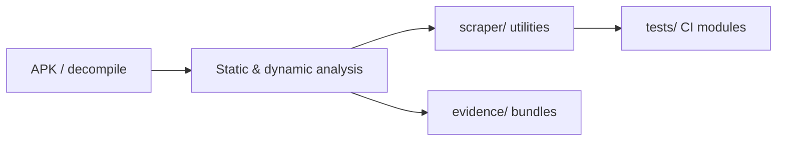

# Eduteria — architecture

## Purpose

Authorized Android application security assessment artifact: decompiled sources, exploitation scripts, scraper utilities, and evidence bundles. Inputs are APK-derived code and backend endpoints; outputs are structured findings, PoC scripts, and reproducible crypto/scraper modules. This tree is **not** a single deployable product — it documents research outcomes and supporting tooling.

## High-level flow

## Module map

| Path | Responsibility |
| --- | --- |
| `scraper/` | AES/crypto helpers, API scrapers, video and course access research scripts |
| `scraper/aes_crypto.py` | App-compatible AES encrypt/decrypt for API payload analysis |
| `scraper/crypto_key_parse.py` | Key derivation helpers mirrored from decompiled Java |
| `evidence/` | Endpoints, API keys, vulnerability write-ups, proof JSON |
| `decompiled/` | Read-only JADX output for reference (large; not executed in CI) |
| `tests/` | Unit tests for crypto and package layout (no live network) |
| `*.py` (root) | One-off assessment and enrollment PoC scripts (manual, authorized use) |

## Extension

1. Add pure functions under `scraper/` with tests in `tests/`.
2. Keep live Firebase/API calls out of unit tests — mock or fixture-only.
3. Document new findings under `evidence/` with severity and reproduction steps.
4. Run `pytest tests -q` before push.

## Testing strategy

- **Unit**: AES round-trip, key parsing, filesystem layout checks (`pytest`, `pythonpath = .`).
- **Manual**: Exploitation scripts against authorized targets only; not run in CI.

## Ethics & scope

Authorized engagements only. See [SECURITY.md](./SECURITY.md).
